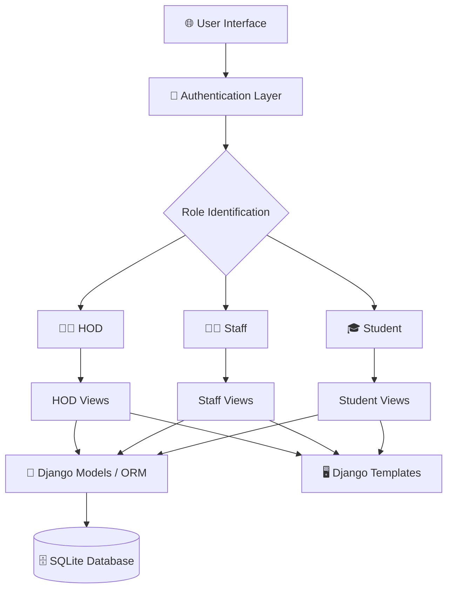
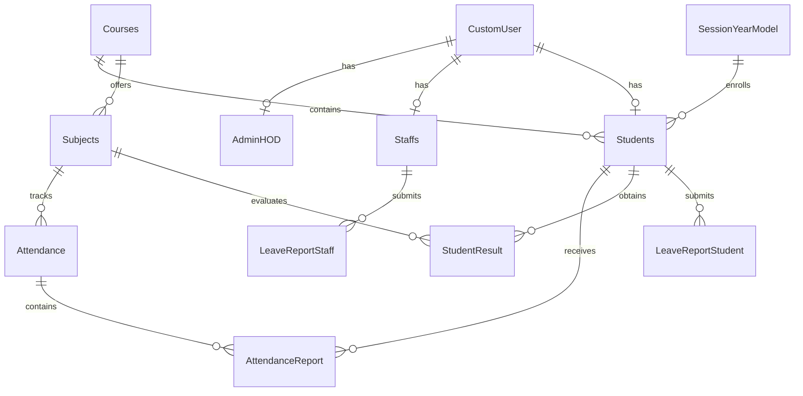

<div align="center">

# 🏛️ SCHOOL MANAGEMENT SYSTEM

### THE DIGITAL BACKBONE OF ACADEMIC ADMINISTRATION

<p>
  <b>One Platform. Three Roles. Complete Academic Control.</b>
</p>

<p>
  A role-based academic management platform engineered with
  <b>Python & Django</b> to simplify institutional operations,
  streamline academic workflows and centralize student information.
</p>

<br/>


<br/><br/>

[🚀 Installation](#-installation) &nbsp; • &nbsp;
[✨ Features](#-features--capabilities) &nbsp; • &nbsp;
[🏗️ Architecture](#️-system-architecture) &nbsp; • &nbsp;
[👨‍💻 Developer](#-developer)

<br/>

</div>

---

## ⚡ PROJECT OVERVIEW

School Management System is a centralized web application designed to bring essential academic and administrative operations into a unified digital environment.

Built on Django's Model-View-Template architecture, the application provides dedicated interfaces and workflows for administrators, teaching staff and students.

Instead of managing academic information across disconnected processes, the platform organizes institutional activities through structured modules, database-backed records and role-specific access.

### 🎯 The Core Idea

| Traditional Administration | Digital Management |
|:---|:---|
| Manual student records | Centralized student database |
| Paper-based attendance | Digital attendance tracking |
| Disconnected academic records | Structured academic information |
| Manual leave applications | Online leave workflows |
| Informal communication | Feedback and notification modules |

---

## ✨ FEATURES & CAPABILITIES

### 🛡️ 01 — ADMINISTRATION CONTROL CENTER

<details open>
<summary><b>👨‍💼 HOD / Administrator</b></summary>

Complete control over the academic structure and institutional operations.

- 📊 Dashboard with academic statistics
- 👨‍🏫 Staff registration and management
- 🎓 Student registration and management
- 📚 Course creation and management
- 📖 Subject allocation and management
- 📅 Academic session management
- 📋 Institution-wide attendance overview
- 📨 Student and staff feedback management
- 💬 Feedback replies
- ✅ Leave approval and rejection
- 👤 Administrator profile management

</details>

### 🎓 02 — STUDENT EXPERIENCE

<details>
<summary><b>🎓 Student Portal</b></summary>

A dedicated environment for students to access their academic information.

- 📊 Personalized student dashboard
- 📅 Attendance overview
- 📈 Attendance records by subject and session
- 📝 Examination and assignment results
- 📤 Online leave applications
- 💬 Feedback submission
- 🔔 Personal notifications
- 👤 Profile management

</details>

### 👨‍🏫 03 — TEACHING & ACADEMIC OPERATIONS

<details>
<summary><b>👨‍🏫 Staff Portal</b></summary>

Academic tools designed to support everyday teaching operations.

- 📊 Staff dashboard
- 📋 Student attendance management
- 🗓️ Attendance creation and updates
- 🎯 Student result entry
- 📝 Examination marks management
- 📤 Leave application submission
- 💬 Administrative feedback
- 🔔 Staff notifications
- 👤 Profile management

</details>

### 🔐 04 — AUTHENTICATION & ACCESS CONTROL

Security and access management built around Django authentication.

- Custom user model extending `AbstractUser`
- Email-based authentication backend
- Role-based user identification
- Custom login-check middleware
- Session-based authentication
- Dedicated HOD, Staff and Student routing

---

## 🧩 FEATURE MATRIX

| Module | HOD | Staff | Student |
|:---|:---:|:---:|:---:|
| Dashboard | ✅ | ✅ | ✅ |
| Student Management | ✅ | — | — |
| Staff Management | ✅ | — | — |
| Course Management | ✅ | — | — |
| Subject Management | ✅ | — | — |
| Attendance Management | View | Manage | View |
| Academic Results | — | Manage | View |
| Leave Applications | Approve / Reject | Apply | Apply |
| Feedback | Review / Reply | Submit | Submit |
| Notifications | Manage workflows | Receive | Receive |
| Profile Management | ✅ | ✅ | ✅ |

---

## 🏗️ SYSTEM ARCHITECTURE

The application follows Django's MVT (Model-View-Template) architecture.



### 🔄 Application Request Lifecycle

1. A user opens the application.
2. The authentication layer validates login credentials.
3. The custom authentication backend identifies the user.
4. The application determines the user's assigned role.
5. Middleware checks the permitted application area.
6. The corresponding view processes the request.
7. Django ORM interacts with the database.
8. The appropriate template renders the response.

---

## 🛠️ TECHNOLOGY ECOSYSTEM

<div align="center">

| Layer | Technology | Responsibility |
|:---|:---|:---|
| Backend | Python | Application logic |
| Framework | Django 5.0.9 | Web application architecture |
| Database | SQLite | Persistent data storage |
| ORM | Django ORM | Database abstraction |
| Frontend | HTML5 | Page structure |
| Styling | CSS3 / Bootstrap | Interface design |
| Scripting | JavaScript | Client-side interactions |
| Visualization | Chart.js | Dashboard charts |
| Authentication | Django Auth | User authentication |
| Middleware | Custom Django Middleware | Role-based request handling |

</div>

---

## 🗂️ PROJECT STRUCTURE

```text
School-Management-System/
│
├── 📂 student_management_app/
│   │
│   ├── 📂 migrations/
│   │
│   ├── 📂 templates/
│   │   ├── 📂 hod_template/
│   │   ├── 📂 staff_template/
│   │   └── 📂 student_template/
│   │
│   ├── 📄 models.py
│   ├── 📄 forms.py
│   ├── 📄 views.py
│   ├── 📄 HodViews.py
│   ├── 📄 StaffViews.py
│   ├── 📄 StudentViews.py
│   ├── 📄 urls.py
│   ├── 📄 admin.py
│   ├── 📄 EmailBackEnd.py
│   └── 📄 LoginCheckMiddleWare.py
│
├── 📂 student_management_system/
│   ├── 📄 settings.py
│   ├── 📄 urls.py
│   ├── 📄 asgi.py
│   └── 📄 wsgi.py
│
├── 📂 static/
│
├── 📄 manage.py
├── 📄 requirements.txt
├── 📄 test_syntax.py
└── 📄 README.md
```

---

## 🗄️ DATABASE DESIGN

The application uses SQLite with Django ORM for relational data management.

### Core Database Entities

| Model | Purpose |
|:---|:---|
| `CustomUser` | Authentication and role identification |
| `AdminHOD` | Administrator profile |
| `Staffs` | Staff information |
| `Students` | Student information |
| `Courses` | Academic course records |
| `Subjects` | Subject and staff associations |
| `SessionYearModel` | Academic session information |
| `Attendance` | Subject-wise attendance sessions |
| `AttendanceReport` | Individual student attendance status |
| `StudentResult` | Examination and assignment marks |
| `LeaveReportStudent` | Student leave records |
| `LeaveReportStaff` | Staff leave records |
| `FeedBackStudent` | Student feedback and replies |
| `FeedBackStaffs` | Staff feedback and replies |
| `NotificationStudent` | Student notifications |
| `NotificationStaffs` | Staff notifications |

### 🔗 Entity Relationship Overview



---

## 🚀 INSTALLATION

Get the application running on your local machine.

### 📋 Prerequisites

- Python 3.10 or later
- pip package manager
- Git
- VS Code or another code editor
- A modern web browser

### 1. Clone Repository

```bash
git clone https://github.com/AradhyaBhardwaj/School-Management-System.git
```

### 2. Enter Project Directory

```bash
cd School-Management-System
```

### 3. Create Virtual Environment

```bash
python -m venv venv
```

### 4. Activate Environment

**Windows:**

```bash
venv\Scripts\activate
```

**Linux / macOS:**

```bash
source venv/bin/activate
```

### 5. Install Dependencies

```bash
python -m pip install --upgrade pip
pip install -r requirements.txt
```

### 6. Apply Database Migrations

```bash
python manage.py migrate
```

### 7. Create Administrator

```bash
python manage.py createsuperuser
```

### 8. Launch Application

```bash
python manage.py runserver
```

<div align="center">

### 

**Open your browser:**

[http://127.0.0.1:8000/](http://127.0.0.1:8000/)

</div>

---

## 🧪 DEVELOPMENT & VALIDATION

The repository includes a Python syntax validation script.

Run:

```bash
python test_syntax.py
```

This checks Python source files for compilation errors.

For Django project configuration checks:

```bash
python manage.py check
```

---

## 🔮 FUTURE DEVELOPMENT ROADMAP

Potential areas for further development:

- [ ] 📱 Progressive Web Application support
- [ ] 📊 Advanced academic analytics
- [ ] 📄 Automated PDF report generation
- [ ] 📧 Email notification integration
- [ ] 📆 Interactive academic calendar
- [ ] 💳 Student fee management
- [ ] 📚 Library management module
- [ ] 📈 Advanced student performance analysis
- [ ] ☁️ Production deployment and cloud hosting

---

## 🔒 SECURITY & DEPLOYMENT NOTES

The project is configured for local development. Before deploying it publicly:

- Set `DEBUG=False`.
- Move `SECRET_KEY` into a secure environment variable.
- Configure `ALLOWED_HOSTS`.
- Review authentication and authorization behavior.
- Configure HTTPS and secure cookies.
- Use a production-ready database when required.
- Configure static and media file serving.
- Never expose credentials or secret keys in source control.

---

## 👨‍💻 DEVELOPER

<div align="center">

### ARADHYA BHARDWAJ

**MCA Student | Software Developer | Data Analytics Enthusiast**

<br/>

<a href="https://github.com/AradhyaBhardwaj">
  
</a>

<br/><br/>

*Building software that transforms ideas into practical solutions.*

</div>

---

## 🤝 CONTRIBUTING

Want to improve the project?

Contributions and constructive suggestions are welcome.

1. Fork this repository.
2. Create a feature branch.
3. Implement your changes.
4. Test your implementation.
5. Commit and push your changes.
6. Submit a Pull Request.

---

## 📜 LICENSE

This repository should be used in accordance with its applicable licensing terms. Check the repository for license information before redistribution.

---

<div align="center">

## 🏛️ SCHOOL MANAGEMENT SYSTEM

### ENGINEERED FOR ORGANIZED EDUCATION.

**Designed to connect administration, teachers and students through one unified platform.**

<br/>

⭐ **Found this project useful? Give the repository a star!**

<br/>


<br/><br/>

**© Aradhya Bhardwaj**

</div>
