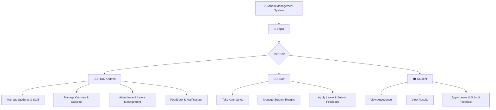

# 🏫 School Management System

### 🎓 A Complete Django-Based Academic & Administration Management Platform

<p align="center">
  
  
  
  
</p>

<p align="center">
  <b>Manage Students. Empower Teachers. Simplify Education.</b>
</p>

---

## 📌 About The Project

**School Management System** is a web-based academic administration platform developed using Python and Django. It provides a centralized environment for managing student records, teaching staff, courses, subjects, attendance, examination results, leave applications, and institutional communication.

The system follows a role-based architecture with dedicated dashboards and functionalities for three different user categories:

- 👨‍💼 **HOD / Administrator** – Manages the institution's academic and administrative operations.
- 👨‍🏫 **Staff / Teachers** – Handles attendance, student results, leave applications, and feedback.
- 🎓 **Students** – Accesses attendance records, examination results, notifications, and academic services.

The primary objective is to reduce manual administrative work, organize academic information, and make everyday school management more efficient.

---

## ✨ Core Features

### 👨‍💼 1. HOD / Admin Dashboard

Centralized administrative control over the institution.

- 📊 Administrative dashboard
- 👨‍🏫 Add, edit, view and manage staff
- 🎓 Register and manage students
- 📚 Create and manage courses
- 📖 Add and manage subjects
- 📅 Manage academic sessions
- 📋 View student attendance records
- 📨 Review student and staff feedback
- 💬 Reply to submitted feedback
- 📝 Approve or reject leave applications
- 👤 Manage administrator profile

### 👨‍🏫 2. Staff Dashboard

Academic management tools for teaching staff.

- 📊 Staff dashboard
- 📋 Take student attendance
- 🗓️ View and update attendance records
- 🎓 Access assigned students
- 📝 Add examination and assignment marks
- 📤 Submit leave applications
- 💬 Submit feedback to administration
- 👤 View and update staff profile

### 🎓 3. Student Dashboard

A dedicated portal for students to access academic information.

- 📊 Student dashboard
- 📅 View attendance records
- 📈 Track attendance information
- 📝 View examination results
- 📤 Apply for leave
- 💬 Submit feedback
- 🔔 Receive notifications
- 👤 View and update student profile

### 🔐 4. Authentication & Authorization

- Secure login and logout functionality
- Custom Django user model
- Role-based access control
- Separate HOD, Staff and Student experiences
- Custom authentication backend
- Login-check middleware

### 📚 5. Academic Management

- Course management
- Subject management
- Academic session management
- Student enrollment
- Staff assignment
- Examination result management

### 📋 6. Attendance Management

- Create attendance records
- Mark students as present or absent
- View attendance by date
- Retrieve student attendance reports
- Update previously recorded attendance
- Maintain attendance history

### 💬 7. Communication & Notifications

- Student feedback submission
- Staff feedback submission
- Administrative feedback replies
- Student notifications
- Staff notifications
- Leave application communication

---

## 🛠️ Technology Stack

| Technology | Purpose |
|---|---|
| 🐍 Python | Core programming language |
| 🌐 Django | Backend web framework |
| 🗄️ SQLite | Relational database |
| 🧱 HTML5 | Webpage structure |
| 🎨 CSS3 | Styling and layouts |
| ⚡ JavaScript | Frontend interactions |
| 🅱️ Bootstrap | Responsive UI components |
| 🔑 Django Authentication | User authentication |
| 🛡️ Django Middleware | Request authorization |
| 📦 Django ORM | Database operations |

---

## 🏗️ Project Architecture

```text
School-Management-System/
│
├── 📂 student_management_app/
│   │
│   ├── 📂 migrations/
│   │
│   ├── 📂 templates/
│   │   ├── 📂 hod_template/
│   │   ├── 📂 staff_template/
│   │   ├── 📂 student_template/
│   │   ├── 📄 base.html
│   │   └── 📄 login.html
│   │
│   ├── 📄 HodViews.py
│   ├── 📄 StaffViews.py
│   ├── 📄 StudentViews.py
│   ├── 📄 views.py
│   ├── 📄 models.py
│   ├── 📄 forms.py
│   ├── 📄 urls.py
│   ├── 📄 admin.py
│   ├── 📄 EmailBackEnd.py
│   └── 📄 LoginCheckMiddleWare.py
│
├── 📂 student_management_system/
│   ├── 📄 settings.py
│   ├── 📄 urls.py
│   ├── 📄 asgi.py
│   └── 📄 wsgi.py
│
├── 📂 static/
│
├── 📄 manage.py
├── 📄 requirements.txt
└── 📄 README.md
```

---

## ⚙️ Installation & Setup

Follow these steps to run the project locally.

### 1️⃣ Clone the Repository

```bash
git clone https://github.com/AradhyaBhardwaj/School-Management-System.git
```

### 2️⃣ Navigate to the Project Directory

```bash
cd School-Management-System
```

### 3️⃣ Create a Virtual Environment

```bash
python -m venv venv
```

### 4️⃣ Activate Virtual Environment

**Windows:**

```bash
venv\Scripts\activate
```

**Linux / macOS:**

```bash
source venv/bin/activate
```

### 5️⃣ Install Dependencies

```bash
python -m pip install --upgrade pip
pip install -r requirements.txt
```

### 6️⃣ Apply Database Migrations

```bash
python manage.py makemigrations
python manage.py migrate
```

### 7️⃣ Create Administrator Account

```bash
python manage.py createsuperuser
```

Follow the terminal instructions to create your administrator credentials.

### 8️⃣ Start Development Server

```bash
python manage.py runserver
```

### 9️⃣ Open in Browser

```text
http://127.0.0.1:8000/
```

🎉 **Your School Management System is now running locally!**

---

## 🗄️ Database Models

The application uses Django ORM with SQLite.

Major database entities include:

| Model | Description |
|---|---|
| `CustomUser` | Custom user authentication and roles |
| `AdminHOD` | Administrator profile |
| `Staffs` | Teaching staff information |
| `Students` | Student information |
| `Courses` | Academic courses |
| `Subjects` | Course subjects and staff assignments |
| `SessionYearModel` | Academic session records |
| `Attendance` | Attendance session information |
| `AttendanceReport` | Individual student attendance |
| `StudentResult` | Examination and assignment marks |
| `LeaveReportStudent` | Student leave applications |
| `LeaveReportStaff` | Staff leave applications |
| `FeedBackStudent` | Student feedback |
| `FeedBackStaffs` | Staff feedback |
| `NotificationStudent` | Student notifications |
| `NotificationStaffs` | Staff notifications |

---

## 🔄 Application Workflow



---

## 🔒 Security & Configuration

The application uses Django's built-in authentication system and custom authorization middleware.

For production deployment:

- Set `DJANGO_DEBUG=False`.
- Configure a secure `DJANGO_SECRET_KEY` environment variable.
- Configure `DJANGO_ALLOWED_HOSTS`.
- Use a production-ready database where appropriate.
- Configure HTTPS and secure cookies.
- Never commit credentials or production secrets to GitHub.

---

## 🚀 Future Enhancements

Potential improvements for future development:

- 📱 Mobile-friendly application experience
- 📊 Advanced academic analytics and reports
- 📧 Automated email notifications
- 📄 PDF report and marksheet generation
- 📆 Interactive academic calendar
- 💳 Online fee management
- 📚 Library management integration
- 📈 Performance tracking and visual analytics
- ☁️ Cloud-based deployment

---

## 🎯 Project Objectives

- Digitize traditional school administration.
- Reduce paperwork and repetitive manual tasks.
- Centralize student and staff information.
- Improve attendance and academic record management.
- Establish structured communication between students, staff and administration.
- Provide role-specific access to academic services.

---

## 👨‍💻 Developer

**Aradhya Bhardwaj**

🎓 MCA Student | 💻 Software Developer | 📊 Data Analytics Enthusiast

**Technical Interests:**
- Python & Django Development
- Database Management Systems
- Web Application Development
- Software Engineering
- Data Analytics

🔗 **GitHub:** [AradhyaBhardwaj](https://github.com/AradhyaBhardwaj)

---

## 🤝 Contributing

Contributions, suggestions, bug reports, and feature requests are welcome.

1. Fork the repository.
2. Create a new feature branch.
3. Commit your changes.
4. Push your branch.
5. Open a Pull Request.

---

## 📜 License

This project is available for educational and development purposes. Please check the repository for applicable licensing terms.

---

<p align="center">
  <b>🏫 School Management System</b>
  <br/>
  <i>Making Academic Administration Simpler, Smarter & More Organized.</i>
  <br/><br/>
  ⭐ If you find this project useful, consider giving it a star on GitHub!
</p>
